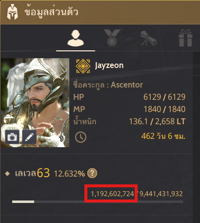

# BDO Training Planner

Static web app คำนวณเวลาเก็บเลเวล Black Desert Online ด้วย Black Spirit's Training (หุ่นฟาง) จนถึงเลเวล 75

**🔗 เข้าใช้งานได้ที่ https://jaynarol.com/bdo-training-planner/**

<p align="center">
  
</p>

ไม่มี build step ไม่มี dependency — แค่ `index.html`, `style.css`, `app.js` ค่าที่กรอกเก็บใน `localStorage` ของเบราว์เซอร์

## สูตรที่ใช้

- **Base EXP** (Boost 0%) = `216,632.965879` EXP ต่อ tick — วัดจากเกม: 6,228,198 ÷ 28.75 (แก้ได้ในตั้งค่าขั้นสูง)
- **EXP ต่อ tick** = `round(Base × (1 + (Boost ต่อสู้ + 100) ÷ 100))`
  - +100 คือบัฟแฝงที่ไม่แสดงในหน้าต่างสถานะ ซึ่งมีอยู่เสมอ (ในเกมเห็น 2675% แต่ได้จริงเท่า 2775%) — ผู้ใช้กรอกแค่ค่า Boost ต่อสู้ตามที่เห็นในเกม
  - หรือกด "กรอก EXP ต่อ tick แทน" เพื่อใส่ค่า EXP ต่อ tick โดยตรง ระบบจะคำนวณ Boost ย้อนกลับให้
- 1 tick ทุก 3 นาที, จำนวน tick = `ceil(EXP ที่ต้องใช้ ÷ EXP ต่อ tick)`
- จำนวนวัน (วันละ N ชม.) = ชั่วโมงรวม ÷ N เช่น 3,724 ชม. ÷ 10 = 372 วัน 4 ชม.
- ตาราง EXP ไม่ใช่ค่าสะสม หลอดรีเซ็ตเป็น 0 ทุกเลเวล แถว N = หลอดของ N → N+1 (ตรงกับแถว `You` ในเกม)
- เวลาแสดงเป็น ปี / เดือน / วัน ตามปฏิทินจริงโดยนับจากวันนี้ (แบบเดียวกับการนับอายุ)
- ในตารางรายเลเวลแสดงเวลาแค่ 3 หน่วยแรก (hover หรือแตะเพื่อดูแบบเต็ม) พร้อม % ที่ได้ต่อชั่วโมง / ต่อ tick ของแต่ละช่วง
- Silver ที่ต้องใช้ = ชั่วโมงเทรนรวม × 1M Silver (แก้อัตราได้ในตั้งค่าขั้นสูง)
- **EXP เสริมรายสัปดาห์** (เปิด/ปิดได้): คัมภีร์ลับต่อสู้ S / M / L / XL (เล่มต่อสัปดาห์) + EXP จากล่ามอนส์เตอร์ต่อสัปดาห์
  - EXP ต่อเล่มคิดตามมาตรฐานเลเวล 66 เป็นค่าคงที่: S 0.2% / M 1% / L 7.5% / XL 15% ของหลอด Lv 66 (46,361,207,358) ใช้ได้ตั้งแต่ Lv 60
  - EXP เสริมถูกเฉลี่ยลงในชั่วโมงเทรนของแต่ละสัปดาห์ (วันละ N ชม. × 7 วัน) แล้วคำนวณเวลาใหม่ทั้งหมด พร้อมบอกว่าเร็วขึ้นเท่าไร

## ฟีเจอร์อื่นๆ

- สลับภาษา ไทย / English ได้ที่มุมขวาบน (จำค่าไว้ใน localStorage)
- ปุ่ม `?` ข้างช่องกรอก แสดงวิธีหาค่าในเกม (ภาพอยู่ใน `assets/`)

## ลิงก์แชร์

ปุ่ม "แชร์" สร้างลิงก์ที่มีค่าที่กรอกไว้ใน URL เช่น
`?lv=65&exp=12.5&unit=pct&boost=1500&h=8`
คนที่เปิดลิงก์จะเห็นผลตามค่านั้นทันที (ค่าจะถูกบันทึกลง localStorage ของเขาด้วย)

## รันในเครื่อง

```bash
npx http-server -p 5173 -c-1 .
```

## Deploy ขึ้น GitHub Pages

```bash
./deploy.sh
```

สคริปต์จะคัดลอกไฟล์เว็บ (`index.html`, `style.css`, `app.js`, `assets/`, `.nojekyll`) ไปไว้ใน repo ชั่วคราว
แล้ว force push ขึ้น branch `gh-pages` ของ `origin` (ถ้ายังไม่มี origin จะใช้ `https://github.com/Jaynarol/bdo-training-planner.git`)
เปลี่ยนปลายทางได้ด้วย `DEPLOY_REMOTE=<url> ./deploy.sh`

ครั้งแรกให้ตั้ง **Settings → Pages → Source: Deploy from a branch → `gh-pages` / `(root)`**
เว็บจะอยู่ที่ https://jaynarol.com/bdo-training-planner/

---

สร้างโดย [Jaynarol](https://github.com/Jaynarol) · [GitHub](https://github.com/Jaynarol/bdo-training-planner)
